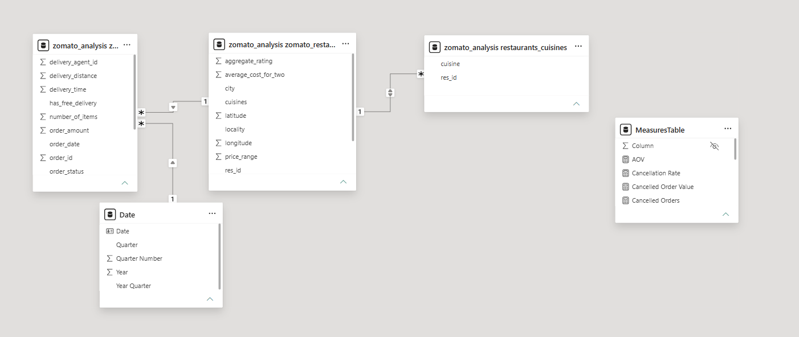
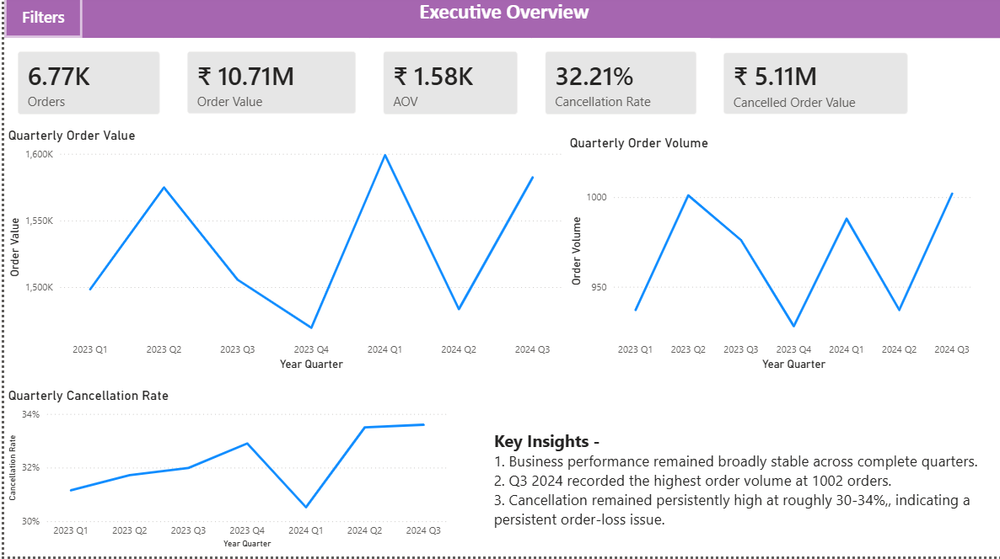
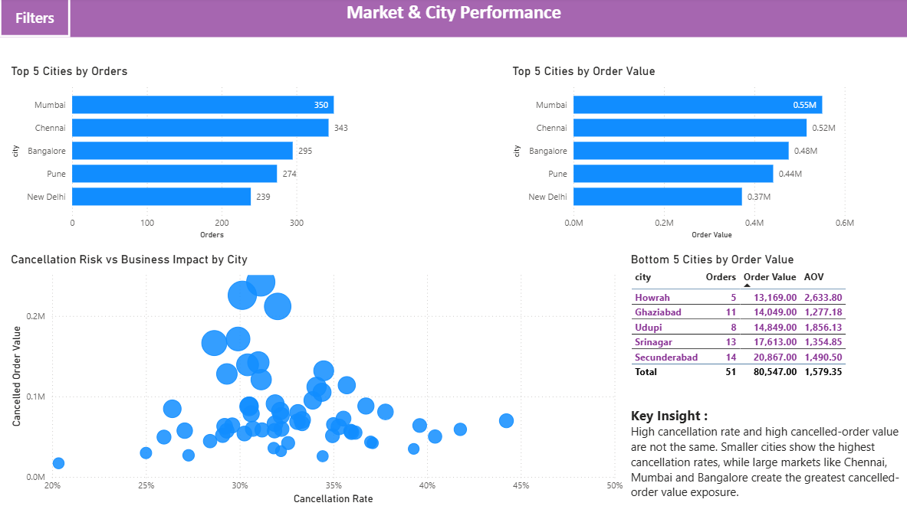
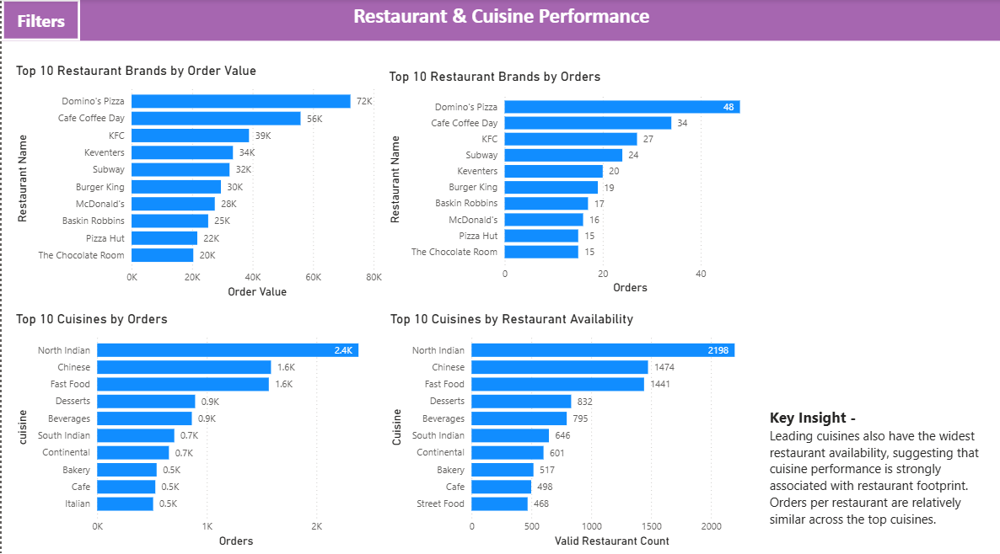

# Zomato Order Performance Analysis

**Tools:** MySQL, Power BI, Excel  
**Project type:** Data analytics portfolio project

## Business Problem & Objective

### Business Problem

Zomato's order data contains information across orders, restaurants, cities, cuisines, order values, and cancellations. The objective of this analysis is to understand **overall business performance, market-level differences, restaurant and cuisine demand, and the scale of order cancellations and associated order-value exposure**.

The analysis focuses on identifying meaningful patterns in order volume and value, understanding where cancellation exposure is concentrated, and evaluating whether restaurant and cuisine performance varies meaningfully across the platform.

### Key Business Questions

1. How has order volume and order value changed over time?
2. How significant and persistent are order cancellations?
3. Which cities contribute the most orders and order value?
4. Which cities carry the greatest cancellation-value exposure?
5. Which restaurant brands generate the highest order volume and value?
6. Which cuisines have the highest demand and restaurant availability?
7. Do delivery time and distance show meaningful relationships with customer ratings or delivery performance?
8. Are there meaningful pricing or promotional patterns **associated with** differences in order performance?

## Dataset & Data Quality

### Dataset

The analysis uses `zomato_data.xlsx`, an order-level dataset with order, restaurant, location, cuisine, status, order-value, delivery, rating, and related attributes.

- **Original received records:** 12,080
- **Working dataset after initial duplicate cleanup:** 12,079 records
- **Unique orders in the final Orders table:** 10,000
- **Unique restaurants in the final Restaurants table:** 8,971

**Data grain:** The final Orders table contains one row per unique `Order ID`. The Restaurants table contains one row per unique `res_id`.

### Data Quality & Preparation

The dataset was reviewed for duplicates, missing values, invalid values, and fields requiring transformation before analysis.

Key preparation steps:

- Removed an exact duplicate record during initial cleanup.
- Examined Order IDs to establish the order-level grain and retained one record per unique Order ID in the final Orders table.
- Reviewed missing values across operational, restaurant, and location-related fields.
- Reviewed zero values in fields such as `aggregate_rating`, `average_cost_for_two`, and latitude/longitude rather than automatically treating them as valid measurements.
- Split multi-cuisine values into a separate **Restaurant–Cuisine Bridge** table to support cuisine-level analysis without duplicating restaurant records.
- Standardized date fields and created a dedicated **Date** table in Power BI for time-based analysis.
- Reviewed order statuses separately because cancelled and in-transit orders are not appropriate for every analytical question.

### Analysis Scope

For the primary time-based analysis, the period was restricted to **1 January 2023–30 September 2024**. The dataset contains only a partial observation for 1 October 2024, which could distort quarterly comparisons if treated as a complete Q4.

Cancelled orders were retained for cancellation analysis and excluded from analyses requiring non-cancelled business activity. For those analyses, **Delivered and In-Transit** orders were treated as non-cancelled; In-Transit orders should not automatically be interpreted as completed deliveries.

## Data Model

The cleaned data was structured into separate tables to support analysis at different levels of granularity and reduce unnecessary duplication.

### Analytical Tables

- **Orders** — one row per unique order, containing transactional attributes such as order date, status, order value, delivery time, and ratings.
- **Restaurants** — one row per restaurant, containing attributes such as restaurant name, city, locality, cuisine source fields, cost, price range, and ratings.
- **Restaurant–Cuisine Bridge** — maps restaurants to their cuisines after multi-cuisine fields were split into individual restaurant–cuisine combinations.
- **Date** — a dedicated calendar table used for time-based analysis and connected to the Orders table through the order date.

### Relationships

The model uses the restaurant identifier (`res_id`) to connect order activity to restaurant attributes. The Date table supports year- and quarter-based analysis. The Restaurant–Cuisine Bridge supports cuisine analysis where a restaurant may serve more than one cuisine.



## Analytical Approach

The analysis was conducted using SQL for data exploration, validation, aggregation, and hypothesis testing, followed by Power BI modelling and dashboard development.

### SQL Analysis

The SQL analysis examined:

- Order volume, order value, average order value (AOV), and trends over time.
- Cancellation counts, rates, and associated order value, including city-level differences.
- City, restaurant-brand, and cuisine performance.
- Delivery time, distance, and customer-rating relationships.
- Pricing, promo-code, and free-delivery comparisons.
- City growth by comparing January–September 2023 with January–September 2024.
- Quarter-by-quarter city growth for Q1–Q3 in the two years, avoiding comparison with incomplete Q4 2024.
- City-level AOV comparisons to distinguish order-volume changes from changes in average order value.

For city-growth comparisons, a minimum-volume threshold of **50 combined non-cancelled orders across the two nine-month periods** was used. This threshold is specific to the growth analysis and is not a universal filter for all city-level analyses.

### Power BI

The Power BI report contains three pages:

1. **Executive Overview** — high-level business performance and cancellation KPIs.
2. **Market & City Performance** — city rankings, city-level performance differences, and cancellation analysis.
3. **Restaurant & Cuisine Performance** — restaurant-brand performance, cuisine demand, and restaurant availability by cuisine.

Year and quarter slicers are synced across pages. A collapsible filter drawer provides access to the time filters.







## Key Findings

### Overall Performance

- Across the valid analysis period, **9,985 orders** were recorded.
- From January–September 2023 to January–September 2024, non-cancelled orders increased from **2,914 to 2,927 (+0.45%)**.
- Order value for the same periods increased from **₹4,578,597 to ₹4,664,811 (+1.88%)**.
- Overall performance was broadly stable, although the city-level results varied considerably.

### Cancellations

- **3,216 of 9,985 orders** were cancelled, a cancellation rate of **32.21%**.
- Cancelled orders had approximately **₹51.05 lakh** in associated order value. This represents cancelled-order exposure, not confirmed financial loss.
- The quarterly cancellation rate increased from **31.99% in Q3 2023 to 33.60% in Q3 2024**.
- Chennai, Mumbai, and Bangalore were among the cities with the highest cancellation counts; some lower-volume cities had higher cancellation rates. Count and rate therefore describe different aspects of cancellation exposure.

### City Growth and AOV

Six cities—**Chandigarh, Bhopal, Ludhiana, Indore, Patiala, and Meerut**—recorded positive year-over-year growth in both non-cancelled order volume and order value across each of the three comparable quarters.

The nine-month city comparison also showed that order volume and value can move in different directions:

- **Bangalore:** orders declined by 6.06%, while order value increased by 14.45%; AOV rose from ₹1,458.91 to ₹1,777.41.
- **Chennai:** orders declined by 9.03%, while order value increased by 6.32%; AOV rose from ₹1,393.90 to ₹1,629.07.
- **Chandigarh and Ludhiana:** order volume grew strongly, while AOV declined.

These are descriptive patterns; the available analysis does not establish the causes of the changes.

### Restaurant and Cuisine Performance

The leading cuisines by non-cancelled orders were:

- **North Indian:** 2,383 orders
- **Chinese:** 1,585 orders
- **Fast Food:** 1,565 orders

Cuisine totals overlap because a restaurant can serve multiple cuisines. Restaurant availability in the Power BI cuisine visual uses the overall Restaurants table footprint, not only restaurants with non-cancelled orders.

### Delivery, Ratings, and Promotions

- Average recorded delivery time was approximately **49.69 minutes**, with values ranging from 10 to 89 minutes.
- The correlation between delivery time and rating was approximately **−0.00235**.
- The correlation between delivery distance and delivery time was approximately **−0.01595**.
- Promo-code orders had an AOV of **₹1,577.02**, compared with **₹1,588.64** for orders without a promo code.
- Free-delivery orders had an AOV of **₹1,593.47**, compared with **₹1,571.88** for orders without free delivery.

The correlations show little overall linear association in the analysed populations, while the promotional comparisons are observational and do not establish causal impact.

## Recommendations

The analysis indicates that overall platform performance remained broadly stable, while city-level growth, cancellations, and order-value patterns varied. The recommendations focus on areas where findings support further investigation or targeted business action.

### 1. Prioritize Cancellation Reduction

- Investigate cities with high cancellation counts to understand their contribution to total cancelled orders and cancelled order value.
- Separately investigate cities with high cancellation rates, including lower-volume markets, to identify potential recurring operational issues.
- Use cancellation reasons and order-stage information to identify preventable causes before implementing corrective measures.
- Monitor cancellation rate, cancelled order count, and associated order value to evaluate subsequent changes.

**Rationale:** Cancellation exposure is substantial, but cancellation count, cancellation rate, and cancelled order value highlight different dimensions of the problem.

### 2. Adopt a Differentiated City-Growth Strategy

- Evaluate Chandigarh, Bhopal, Ludhiana, Indore, Patiala, and Meerut for potential growth opportunities, as all six recorded positive order-volume and order-value growth across Q1–Q3 in the year-over-year comparison.
- Investigate declining markets, including Kolkata and Mumbai, to understand changes in demand and order value before committing additional resources.
- Assess order volume and AOV together where their trends diverge, as observed in Bangalore and Chennai.
- Consider cancellation performance and operational capacity before prioritizing expansion.

**Rationale:** Platform-level stability conceals substantial differences across cities, making a uniform growth strategy unsuitable without further investigation.

### 3. Align Cuisine Coverage with Observed Demand

- Maintain reliable restaurant coverage for high-demand cuisines, including North Indian, Chinese, and Fast Food.
- Evaluate cuisine demand alongside restaurant availability at the city level before identifying opportunities for restaurant onboarding or assortment expansion.
- Review restaurant partners using multiple indicators, including order activity, order value, customer ratings, and cancellation performance.

**Rationale:** High cuisine order counts indicate substantial observed demand, but do not independently establish unmet demand, profitability, or stronger performance per restaurant.

### 4. Evaluate Promotions Using Incremental Business Outcomes

- Assess promotional and free-delivery initiatives using completed orders, repeat behaviour, offer costs, and contribution margin rather than AOV alone.
- Use controlled tests or suitable comparison groups where feasible to assess whether offers generate incremental demand.
- Review performance across relevant city and customer segments before expanding promotional investment.

**Rationale:** The observed AOV differences do not establish that promotions cause higher spending or improve profitability.

### 5. Investigate Delivery Performance Using More Granular Evidence

- Monitor delivery-time distributions and investigate unusually long deliveries or operational differences across cities.
- Avoid assuming that delivery time alone explains customer ratings or that distance alone determines delivery duration.
- Use more detailed operational data to investigate specific service problems before selecting interventions.

**Rationale:** The overall correlation analysis showed little linear association between delivery time and ratings, or between distance and delivery time. These results do not rule out relationships within specific segments.

## Limitations

The findings should be interpreted in the context of the dataset's coverage, data quality, and analytical scope.

### Data Coverage and Quality

- The dataset contains only a partial observation for **1 October 2024**. The primary analysis was restricted to **30 September 2024** to avoid distorting quarterly comparisons.
- The analysis retained one record per unique Order ID; this assumes Order ID represents the appropriate order-level grain.
- Some fields contained missing or zero values, including ratings, average cost, geographic coordinates, and restaurant attributes. These values may limit analyses that depend on them.
- The available dataset does not provide enough detail on cancellation reasons to establish the operational causes of cancelled orders.

### Analytical Limitations

- **Order status:** Delivered and In-Transit orders were treated as non-cancelled for selected analyses. In-Transit orders may not represent completed deliveries.
- **Cancellation exposure:** Cancelled order value is not confirmed revenue loss, lost profit, or recoverable business value.
- **Cuisine attribution:** Restaurants may offer multiple cuisines, so cuisine-level counts overlap and are not mutually exclusive.
- **Restaurant availability:** Restaurant counts use the overall restaurant footprint and may not represent restaurants with active orders during the analysis period.
- **Correlation analysis:** Correlation measures linear association and does not establish causality or rule out non-linear or segment-specific patterns.
- **Promotional comparisons:** Differences between orders with and without offers are observational and do not establish incremental impact or profitability.
- **City growth:** Historical growth does not guarantee future demand or profitability; percentages may be volatile for smaller order bases.

### Further Data Required

Additional cancellation-reason, order-stage, revenue, delivery-cost, discount, contribution-margin, customer-retention, and operational data would strengthen the analysis and help quantify the potential impact of the recommended interventions.

## Project Structure

```text
Zomato-Order-Performance-Analysis/
├── README.md
├── sql/
│   └── zomato_analysis_sql.sql
├── powerbi/
│   └── zomato-order-analysis-report.pbix
└── screenshots/
    ├── data-model.png
    ├── executive-overview.png
    ├── market-city-performance.png
    └── restaurant-cuisine-performance.png
```
## Project Files

- [SQL Analysis Script](sql/zomato_analysis_sql.sql)
- [Power BI Report](powerbi/zomato-order-analysis-report.pbix)

## Tools Used

- **MySQL Workbench** — querying, aggregation, validation, and analysis.
- **Power BI** — data modelling, measures, interactive visuals, and dashboard development.
- **Excel** — source data review and preparation.
